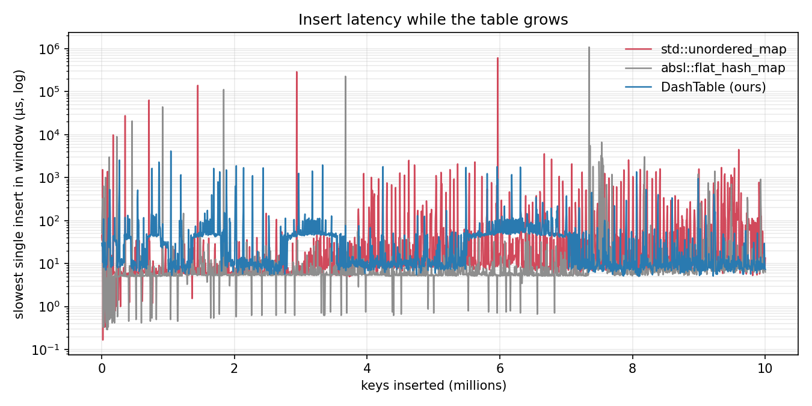

# Benchmarks

- Machine: Docker Desktop's Linux VM (kernel 6.10 linuxkit, arm64, 8 vCPUs, 7.7 GB) on an Apple M2.
- Build: `release` preset (`-O2 -march=native`), GCC 13.3.
- Load: `redis-benchmark` 7.0.15 **on the same VM as the server**, so client and server share the 8 vCPUs. These numbers show trends, not what the server does on real hardware. The vCPUs are host threads macOS schedules onto performance and efficiency cores, so pinning inside the VM doesn't pin to hardware.
- Medians of 3 runs. Raw rows and each run's `testbed.txt` are in `bench/results/`.

## One thread vs Redis

`redis-benchmark -c 50 -P 16 -t set,get -r 1000000`, server pinned to CPU 0, client on CPUs 1 to 7.

| Server | SET/s | GET/s |
| --- | ---: | ---: |
| Redis 7.0.15 (Ubuntu package) | 1,374,570 | 1,414,427 |
| kv_server, 1 thread, epoll | 2,100,840 | 2,372,479 |
| kv_server, 1 thread, io_uring | 2,389,486 | 2,673,797 |

## Storage

16-byte keys and 16-byte values; 10M inserts for latency, 1M keys for memory and lookups. `bench/micro/` has the programs.

| | DashTable (ours) | std::unordered_map | absl::flat_hash_map |
| --- | ---: | ---: | ---: |
| Slowest single insert while growing | 4.1 ms | 612 ms | 1,086 ms |
| p99.9 insert | 41 µs | 7 µs | 3.6 µs |
| Bytes per key (whole table) | 64 | 172 | 200 |
| Lookup hit | 356 ns | 296 ns | 125 ns |
| Lookup miss | 112 ns | 150 ns | 8 ns |

The segmented table splits one 840-slot segment at a time, so it trades rare whole-table rehashes for frequent splits of tens of µs. Lookups are slower than absl's.

A `CompactKey` is 18 bytes for keys up to 16 bytes, or up to 8 bytes with a TTL. A `std::string` key costs 32 to 64 bytes, plus 8 for a TTL.

## Scaling

`redis-benchmark -c 200 -P 16 -t set,get -r 1000000 --threads 4`, server `--pin`. SET/s:

| Threads | epoll | io_uring |
| --- | ---: | ---: |
| 1 | 1,596,169 | 1,994,018 |
| 2 | 2,659,574 | 2,659,574 |
| 4 | 3,192,338 | 3,189,793 |
| 8 | 2,657,807 | 2,657,807 |

Throughput rises to 4 threads. At 8, the 8 server threads and 4 client threads oversubscribe 8 vCPUs, and the 4-thread plateau is the client's ceiling. Values that repeat exactly come from redis-benchmark's millisecond timer. This needs a separate load-generator host.

## Syscalls per request

4 server threads, `-t set,get -r 1000000`, counted by the server itself (`INFO syscalls`) and divided by commands processed.

| Backend | `-c 50 -P 1` | `-c 50 -P 16` |
| --- | ---: | ---: |
| epoll | 2.646 | 0.258 |
| io_uring, one recv per read, eventfd wakeups | 0.717 | 0.063 |
| io_uring, multishot recv, eventfd wakeups | 0.713 | 0.061 |
| io_uring, multishot recv, MSG_RING wakeups | 0.466 | 0.039 |

`strace -c -f` on a shorter pipelined run agrees: 0.207 for epoll, 0.022 for io_uring (strace slows the server, which changes batching). The only syscalls strace sees that the counters don't are glibc's `mprotect` and `futex`, about 0.001 per request.
